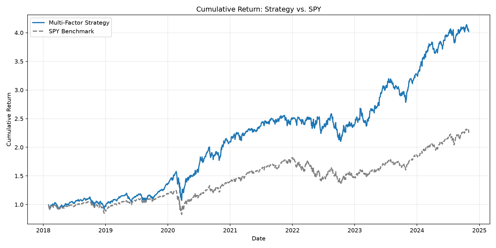
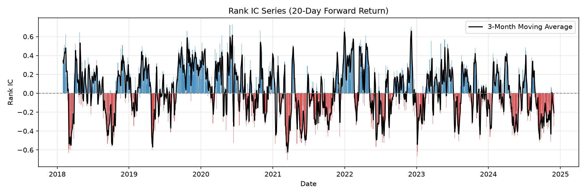
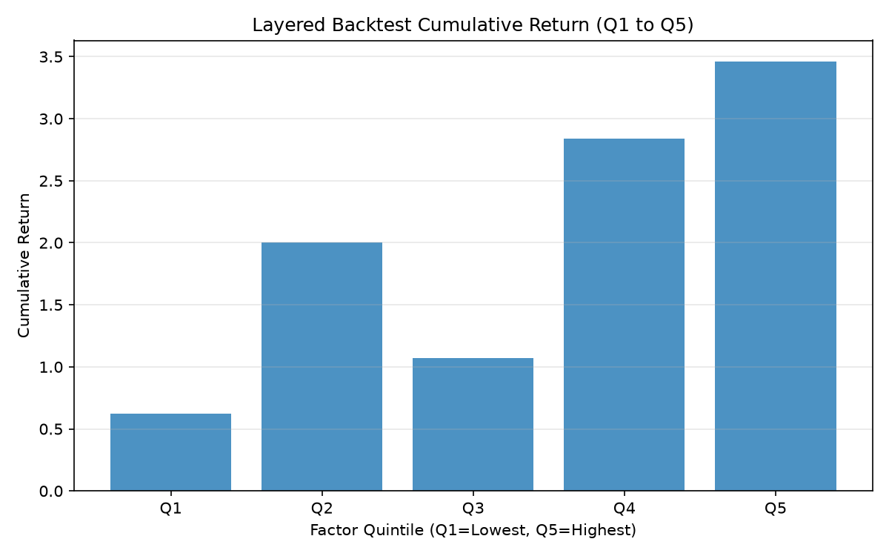

# Multi-Factor Stock Selection Backtest

## Overview
A quantitative multi-factor backtest framework for US equities. This project evaluates the predictive power of classic equity factors (momentum, volatility, turnover, and short-term reversal) using Rank IC analysis and quintile layered backtests, with a focus on realistic implementation (transaction costs, benchmark comparison).

## Methodology
- **Universe:** 30 large-cap US stocks (Note: contains survivorship bias, see limitations).
- **Factors:** 
  - 20-day Momentum
  - 20-day Volatility (inverted)
  - 20-day Log Turnover
  - 5-day Reversal
- **Preprocessing:** Winsorization (±3σ), z-score standardization, equal-weight composite.
- **Rebalancing:** Monthly, equal-weight top 10 stocks.
- **Benchmark:** SPY (S&P 500 ETF).
- **Transaction Cost:** 10 bps one-way (deducted based on monthly turnover).

## Results (2018 - 2024)

| Metric | Strategy (Net of Fees) | SPY Benchmark | Excess / Info Ratio |
| :--- | :--- | :--- | :--- |
| **Total Return** | 276.16% | 125.15% | - |
| **Annualized Return** | 21.71% | 12.79% | 8.02% (Excess) |
| **Annualized Volatility**| 21.65% | 19.68% | - |
| **Sharpe Ratio** | 1.00 | 0.65 | - |
| **Max Drawdown** | -32.14% | -33.72% | - |
| **Information Ratio** | - | - | **0.79** |
| **Avg Monthly Turnover**| 58.07% | - | - |

### Factor IC Analysis (20-Day Forward Return)
- **Mean Rank IC:** 0.0230
- **ICIR:** 0.0869
- **IC Win Rate:** 53.95%

### Quintile Layered Backtest (Cumulative Return)
- **Q1 (Lowest):** 62.56%
- **Q2:** 200.00%
- **Q3:** 107.12%
- **Q4:** 283.69%
- **Q5 (Highest):** 345.81%

## Key Insights & Known Limitations
1. **Head-Tail Effectiveness:** The strategy demonstrates strong head effect. Q5 (highest factor score) significantly outperforms Q1 (62.5%) and the benchmark, driving the portfolio's alpha.
2. **Survivorship Bias (Primary Limitation):** The current universe consists of 30 well-known large-cap stocks (e.g., AAPL, NVDA). This creates an upward bias for absolute returns. Future iterations will incorporate historical S&P 500 constituents.
3. **Low ICIR due to Small Cross-Section:** The low ICIR (~0.09) and the non-monotonic Q3 are primarily caused by the small cross-section (30 stocks = 6 stocks per quintile). Individual stock idiosyncratic volatility heavily distorts the rank correlation. Expanding the universe to 500+ stocks will smooth out this noise.
4. **Turnover & Cost:** Monthly turnover is ~58%, costing roughly 1.39% annualized. Momentum and short-term reversal factors inherently conflict, leading to high turnover.

## Visualizations




## How to Run
```bash
pip install -r requirements.txt
python backtest.py
